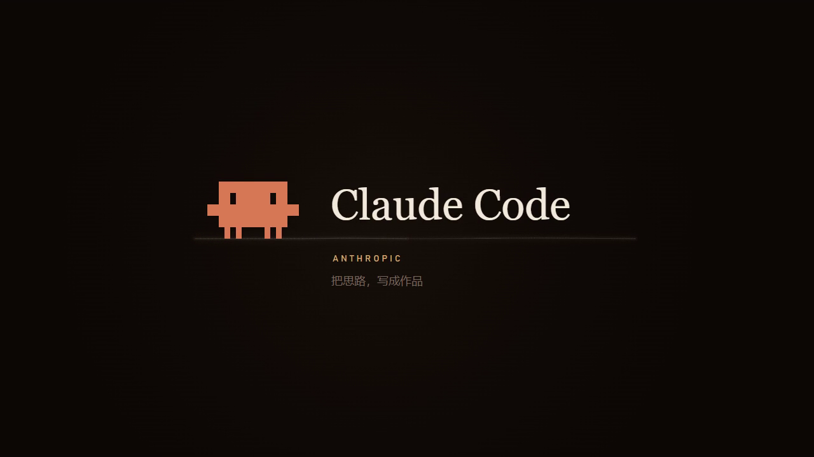

# 鲸启 · DSH Awakening

可更换作品的 DSH 开机动画插件。内置 **DeepSeek · 鲸启、Codex · 构想成形、Claude Code · 光标唤醒** 三款22秒有声作品，可在插件内预览、切换，也可导入 MP4 / WebM 或浏览社区动画库。

**正式版：[v0.7.0](https://github.com/MingoYung/dsh-awakening/releases/tag/v0.7.0)** · [预构建安装包](https://github.com/MingoYung/dsh-awakening/releases/download/v0.7.0/dsh-awakening-0.7.0.tgz) · [动画库](https://github.com/MingoYung/dsh-awakening-library)

以下设置图来自独立浏览器中的真实插件组件，不是 DSH 冷启动截图。


## 三款内置作品

| 作品 | 画面与声音 |
| --- | --- |
| DeepSeek · 鲸启 | 鲸鱼标志、星点归流与光带，接入新制作的深海角色显形和欢迎语。 |
| Codex · 构想成形 | Codex 云形终端标识、铂金与薄荷色动效，接入银发编程伙伴和欢迎语。 |
| Claude Code · 光标唤醒 | 终端光标唤醒像素小蟹，横向衬线字标、柔韧光流与铜棕发编程学者；包含欢迎语。 |

三款随插件提供，可离线预览、选用。内置 DeepSeek 替换了旧版借用的角色结尾；三款新人物和有声显形片段均由本项目通过 AI 工具辅助制作。它们是独立同人作品，不是模型厂商的官方拟人形象，也不表示 DeepSeek、OpenAI、Anthropic 或 DSH 官方发布、合作与背书。

程序代码采用 MIT；本项目有权许可的新增动画、原创音效和生成角色素材采用有范围说明的 CC BY 4.0。产品名称、商标和品牌图形分别保留权利，不能将它们一并改称 MIT 或 CC BY 原创素材。见 [CREDITS.md](CREDITS.md) 和[媒体许可范围](licenses/ORIGINAL-ANIMATIONS-CC-BY-4.0.md)。



## 安装与升级

使用插件市场提供的预构建安装包，或通过 DSH 原生插件管理器添加已解压插件目录。也可在 DSH 终端中执行：

```sh
dsh plugin add /absolute/path/to/dsh-awakening
```

安装或升级后重启 DSH。仓库和 `.tgz` 均提供客户端构建结果、媒体与本机工具，正常安装不需要本机构建。未发布至 npm，请以本仓库及固定 Release 为来源。

从旧版升级会保留音量、播放频率和本地导入的视频；`builtin:awakening` 仍代表默认 DeepSeek 作品。已安装首屏兼容层的用户，需要在设置中的“首屏播放”显式选择“更新并重启”一次；普通插件更新不会悄悄改写桌面应用包。

## 预览、更换与社区动画库

入口：**设置 → 鲸启启动动画**，分为“当前动画”“动画库”“播放设置”，控件跟随 DSH 主题。

- **当前动画**：预览正在使用的作品，进入作品详情或更换。
- **动画库**：三款内置作品、已导入视频及社区作品使用同一套页内卡片和详情。浏览、预览、下载与选用均可在插件内完成。内置作品保留为离线选择，不能移除。
- **播放设置**：开关、声音、音量、每次启动或每日首次、普通视频取景方式；首屏管理和高级项折叠收纳。

点“导入动画”选择本机 MP4 / WebM，默认仅供本机使用，不会上传。视频需1–45秒、不超过120 MiB；推荐 H.264/AAC MP4 或 VP9/Opus WebM。“导入并使用”“下载并使用”会明确保存并选用；只预览、只下载或只导入会保留当前选择。用户视频保存于 `DSH_HOME/awakening-library/`，标准安装为用户 `.dsh/awakening-library/`，插件升级不会覆盖这些文件。

社区目录在首次打开时获取，有缓存则先显示缓存；也可主动刷新。下载核对声明长度和 SHA256，失败保留原作品。正常开机只播放本地资源，不依赖 GitHub 连接。社区库的三个入门作品与本版内置作品对应；创作者可按[投稿说明](https://github.com/MingoYung/dsh-awakening-library/blob/main/CONTRIBUTING.md)提交完整视频及来源许可，审核后加入目录。播放器不下载或执行创作者脚本。

## 窗口自适应与播放

三款内置作品使用单个原生 video 提供画面时间和音轨，Canvas 根据各作品的时间段与关键内容安全区调整取景。横窗、窄窗和竖窗连续适配；Claude Code 的横向字标与角色面部采用不同的取景范围。外围暗区可被裁切，同色环境用于有限源画幅之外，不做模糊或镜像补边。极端长条窗口不承诺保留每一处边缘。

更换窗口大小只更新画布构图，不 seek、不重播，也不创建第二个音轨。输出尺寸和绘制频率有限制；Canvas 不可用时恢复原生视频与退出机制。普通导入/社区视频使用“填满窗口”或“完整画面”，不会自动获得内置作品的安全区元数据。

动画结束且工作界面就绪后退出；可随时按 **Esc** 或点击跳过。媒体失败、宿主报告启动失败或等待超时会让出界面。有声自动播放被阻止时提示点击开始，避免静音口型。播放上限会容纳所选视频及缓冲，最长60秒。

打开包内 `preview.html` 可使用相同播放器做独立预览；浏览器预览不等于实际 DSH 冷启动验收。

## 可选：从最早首屏开始播放

普通插件在 Host 就绪后注入。可选首屏兼容层接入桌面初始页面，让动画与后台加载并行，Host 接管同一个播放器和声音。

当前支持已核验的 **Windows DSH NEXT 2.0.19-next 与 2.0.21-next 两种特定 EXE / 原始 ASAR 构建**；2.0.21-next 所带内核为 0.2.1-rc.4。工具按实际 EXE 摘要选择对应构建 profile，再核对该构建的原包或受管理包；显示版本号相同而文件不同也会拒绝。未知构建不会回退套用旧版 policy。完整摘要与范围见 [COMPATIBILITY.md](COMPATIBILITY.md)；其他版本、操作系统和普通浏览器仍可使用普通插件播放。

在 **播放设置 → 首屏播放** 查看状态，明确选择“安装并重启”“更新并重启”或“恢复默认首屏并重启”。先保存工作；工具先准备可恢复的包，再正常退出 DSH，等待全部进程退出后校验、原子替换并重开。它不会强杀进程，不用固定延时猜测退出。取消、未知构建或校验失败会保留原包。

该功能会显式修改 DSH 的 `resources/app.asar`，原始备份在同目录 `.dsh-awakening-backup/app.asar`。每种构建只接受自身原包及其摘要匹配的备份，不跨构建恢复；宿主升级后旧备份不能替代新原包，备份消失时先重新核验当前原包。不改 EXE、Electron fuse、快捷方式或账户配置。DSH 升级后需重新核验，不自动套用旧补丁。0.7.0 兼容载体按随包清单核对三款媒体和安全构图配置；更换作品不需要每次重写 ASAR。

2.0.21-next 接管保留原生 boot 的 `documentId` / `profile`、sender 校验与真实界面健康报告；动画与 UI 并行挂载，不伪报 healthy，不放宽原生请求鉴权。验证范围区分离线副本检查与实机启动，冷/热启动及窗口状态恢复结果分别记录。

手动入口：

```powershell
& './tools/native-install/Install-FirstScreen.ps1' -Action Install
# 恢复：-Action Rollback；只检查：-Action Inspect
```

高级项中的“重置播放设置”只重置播放选项并切回默认作品，保留用户视频；首屏管理里的恢复按钮才恢复桌面原包。完整边界见 [COMPATIBILITY.md](COMPATIBILITY.md)。

## 开发与验证

```sh
npm ci --ignore-scripts
npm run build
npm run verify
npm pack --ignore-scripts
```

`scripts/build.mjs` 将客户端注册为 DSH `window.__ModuleLoader__.load` 工厂。正式包提供构建结果，无 npm 安装期脚本。

| 文件 | 职责 |
| --- | --- |
| `lib/index.js`、`lib/animation-library.mjs` | Host 注入、作品列表、导入、校验下载及媒体路由 |
| `media/builtins.json` | 三款内置作品的固定 ID、摘要、来源和安全构图数据 |
| `runtime/bootstrap.js`、`runtime/stage.js`、`runtime/safe-video.js` | 单播放器、尺寸适配、跳过和清理 |
| `src/` | 当前动画、页内动画库、播放设置与首屏确认 |
| `tools/native-install/` | 已核验构建的离线准备、退出等待、升级与恢复 |

验证记录区分离线结构/浏览器/副本安装器检查与本机人工验收，见 [verification/](verification/)。普通模式与首屏兼容的能力不能混为一谈；本项目不承诺未核验桌面构建的最早首帧接管。
