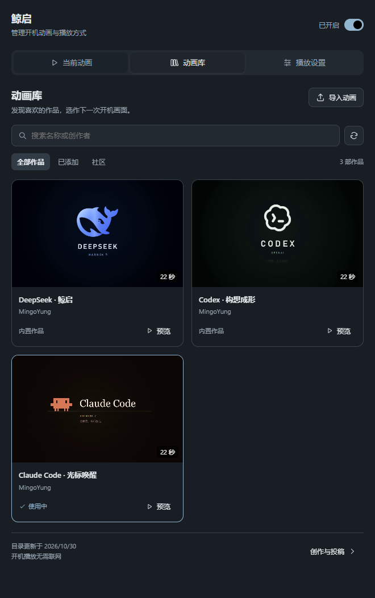
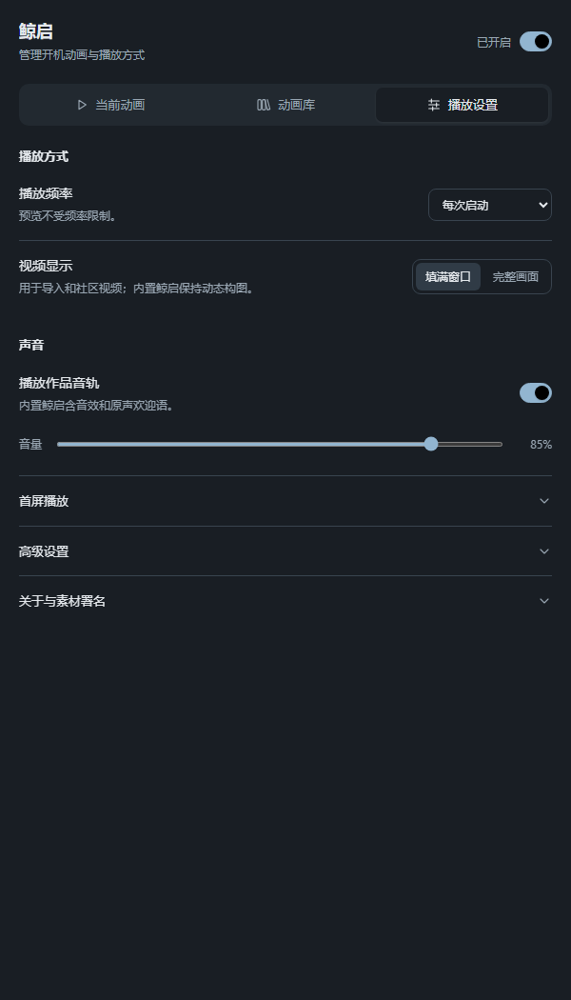
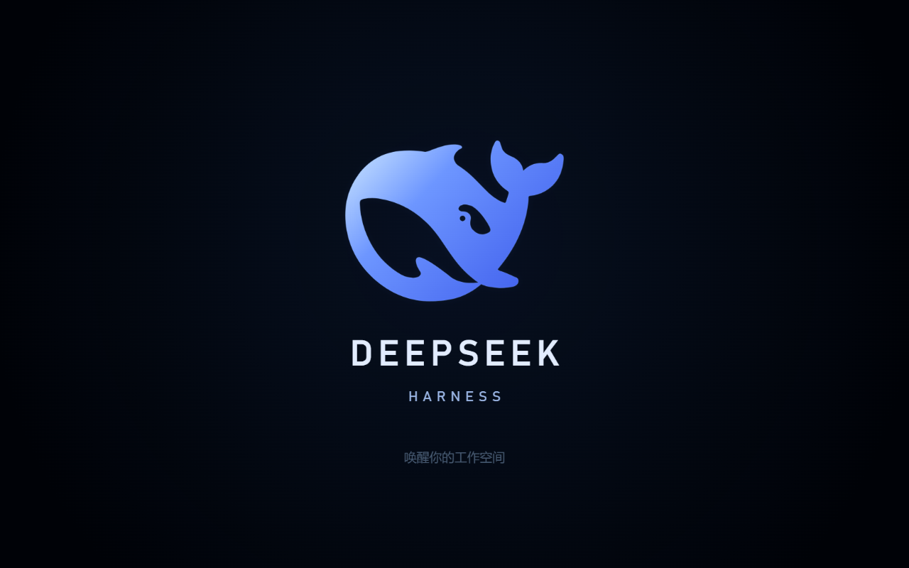

# 鲸启 · DSH Awakening

可更换作品的 DSH 开机动画插件。内置以鲸鱼标志展开的22秒“鲸启”，包含文字组装、材质聚散、星点归流、连接光带及原声欢迎语；也可导入自己的 MP4 / WebM，从社区动画库下载其他创作者的作品，并在设置中预览、选用。

项目地址：<https://github.com/MingoYung/dsh-awakening>。这是社区兼容插件，不表示官方发布或背书。

**当前正式版：[v0.6.1](https://github.com/MingoYung/dsh-awakening/releases/tag/v0.6.1)。** 包含动画切换、本地导入、插件内社区动画库与三页设置界面。可下载预构建 [安装包](https://github.com/MingoYung/dsh-awakening/releases/download/v0.6.1/dsh-awakening-0.6.1.tgz)，不需要本机构建。验证范围见 [v0.6.1记录](verification/v0.6.1.json)；此前 `v0.6.0` 预发布快照保留。

**素材说明：** 前段动效、排版、程序音效和播放器由本项目制作；约13.6秒起的角色影像及原声欢迎语引用自 [lxj5820/dsh-boot-animation](https://github.com/lxj5820/dsh-boot-animation) 的 `assets/videos/1.mp4`，不是本项目原创角色短片。该上游固定版本将视频列入 MIT 许可，本项目保留原作者版权与许可正文。完整来源、范围及版本见 [CREDITS.md](CREDITS.md)。

## 更换动画与社区作品

入口：**设置 → 鲸启启动动画**。页面分为“当前动画”“动画库”“播放设置”，颜色与字体跟随DSH主题。

“当前动画”集中展示正在使用的作品、预览和更换入口；“动画库”在插件内显示封面卡片、分类搜索和作品详情，浏览、预览、下载及选用均可在页内完成。“播放设置”集中调整声音、频率与取景，首屏工具和高级选项折叠收纳。

1. 在动画库点“导入动画”，选择本机 MP4 / WebM，名称自动填写、作者可选。默认“仅供本机使用”，导入不会上传或公开文件。视频需1–45秒、不超过120 MiB；推荐 H.264/AAC MP4，或 VP9/Opus WebM。
2. 点封面查看页内详情，可先预览再使用。明确点击“导入并使用”或“下载并使用”可一步保存并选用；仅下载、仅导入和预览均保留原选择。
3. 普通视频可选“填满窗口”（居中取景，边缘可能裁掉）或“完整画面”（保留完整源画面，比例不同时有留边）。内置鲸启继续使用程序动态构图，视频作品不会自动重新排版人物和字幕。
4. 当前作品需先切换到其他作品才能移除。“重置播放设置”会切回内置鲸启，已导入的作品仍保留。

**社区库：[MingoYung/dsh-awakening-library](https://github.com/MingoYung/dsh-awakening-library)**。第一次打开插件内动画库时获取目录，有缓存则先显示缓存；也可点刷新按钮更新。每次下载都核对声明大小与 SHA256，失败保留原作品；正常开机只读本地文件，不依赖 GitHub 连接。库初始仅包含已署名的内置鲸启，其他作品会在创作者投稿审核后加入。

创作者阅读[投稿说明](https://github.com/MingoYung/dsh-awakening-library/blob/main/CONTRIBUTING.md)，按模板提交一个作品条目，提供固定版本视频链接、预览、作者及许可。库接收完整视频，不接收会在使用者机器执行的作者脚本、网页或安装程序。作品的媒体许可由原作者声明，库的 MIT 不会覆盖它们。

作品存于 `DSH_HOME/awakening-library/`（标准安装为用户 `.dsh/awakening-library/`），选择及显示方式仍由 DSH configForms 保存。插件更新不会覆盖用户视频，发布包也不包含用户导入文件。文件丢失或校验不符时设置页提示，普通播放回到内置作品；首屏层保守让出界面。

设置页预览（独立浏览器中的真实面板与隔离数据，不是实机启动截图）：



## 安装

使用 DSH 原生插件管理器添加已解压插件目录的绝对路径，或在 DSH 终端中执行：

```sh
dsh plugin add /absolute/path/to/dsh-awakening
```

首次安装后重启 DSH。本地 link 安装应保留插件目录；卸载通过 DSH 插件管理器移除。仓库和预构建 `.tgz` 均包含客户端构建结果及媒体，正常安装不需要执行构建脚本。未发布至 npm，请勿从同名 npm 包推断其来源。

### 可选：从最早首屏开始播放

0.5.0提供首屏兼容安装入口。普通插件在Host就绪后播放；安装兼容层后，同一个播放器从桌面初始页面开始，动画与后台加载并行，Host接管时继续原进度和声音。

目前只支持已核验的 **Windows DSH NEXT 2.0.19-next 特定构建**。安装器同时检查EXE、应用包与动画资源，不仅检查显示版本号。其它桌面版本、操作系统和普通浏览器仍可使用普通动画，首屏兼容入口会说明当前环境是否受支持。

1. 打开 **设置 → 鲸启启动动画 → 播放设置 → 首屏播放**，查看检测结果。
2. 点“安装并重启”，确认前先保存工作。工具先准备补丁和可恢复的原包，再正常退出DSH。
3. 独立脚本等全部DSH进程退出，完成原子替换并核对后，重新打开原来的DSH。这个过程根据真实退出状态推进，不使用固定延时猜测。

设置页也提供恢复默认首屏的入口。取消退出、准备失败、版本不匹配或校验失败时，工具保留当前应用包并给出结果；不会强杀DSH进程。无需npm、额外Node或在线下载运行依赖。

从0.5.0或0.6.0升级到0.6.1后，已装的首屏兼容层需要通过设置中的“更新并重启”升级一次，才能在最早首屏识别新插件包。升级前普通Host播放仍可用；升级完成后，更换作品只需选用并下次正常启动，不会为每次换片重写ASAR。原包备份、已有播放设置和用户动画库均保留。

已安装时显示“恢复默认首屏并重启”；恢复后才显示“安装并重启”。“播放设置 → 高级设置”中的“重置播放设置”只重置播放选项，不改变首屏兼容的安装状态。

兼容层会显式修改本机DSH的`resources/app.asar`，原包保存在同目录`.dsh-awakening-backup/app.asar`。DSH升级后需重新检查支持情况；安装器会拒绝向未知构建套用旧补丁。它不会改EXE、快捷方式或账户配置。

也可在完整插件目录中运行随包脚本：

```powershell
& './tools/native-install/Install-FirstScreen.ps1' -Action Install
# 恢复默认首屏：将Install改为Rollback；Inspect只检查状态。
```

手动脚本使用DSH自带的Node完成准备，然后提示你从DSH菜单或托盘退出；它会等待退出、应用并重新打开。设置页按钮通过桌面公开退出接口完成这一步。手动脚本不假装用“关闭窗口”代替退出，也不会强制结束进程。自定义安装位置可用`-Executable`提供DSH NEXT EXE的绝对路径，仍须通过同样的构建检查。

播放设置预览，首屏管理默认折叠收纳（隔离浏览器夹具）：



## 设置

入口：**DSH 设置 → 鲸启启动动画**。

| 设置 | 默认值 | 行为 |
| --- | --- | --- |
| 开启启动动画 | 开 | 关闭自动播放，仍可手动预览 |
| 播放频率 | 每次启动 | 可改为每日首次；同一窗口刷新不反复播放 |
| 播放声音 | 开 | 包含界面音效与角色欢迎语 |
| 音量 | 85% | 0–100%，由宿主确认保存 |
| 启动等待上限 | 45秒 | 高级项，25–60秒；超时让出界面 |
| 当前动画 | 内置鲸启 | 可选本地导入或社区下载作品，下次启动生效 |
| 普通视频显示方式 | 填满窗口 | 可改完整画面；不影响内置鲸启的动态构图 |

支持完整预览、重置播放设置、Esc 和点击跳过。“高级设置”中的“重置播放设置”重置播放选项并切回内置作品，保留动画库；首屏管理中的“恢复默认首屏并重启”才恢复桌面原包。实际上限至少容纳作品长度及3秒缓冲，最长60秒。设置页显示当前作品的作者、许可和来源；内置作品的配色、22秒节奏及欢迎语保持确认版本。

## 自适应

本节描述内置鲸启。其他作品使用所选的普通视频显示方式，不宣称具备同样的程序响应式构图。

0.4.0 根据窗口客户区的实际宽高连续计算构图，不切换一组固定比例视频，也不使用0.3.0的方形补边方案。拉动窗口、最大化或全屏不重播、不切换音轨。前段按源几何绘制，后段按焦点取景；外围发梢和尾鳍可出画，脸与口型保留在常见桌面及竖屏构图内。

竖版归流阶段跟随一条清楚可读的左光带，再在人物轮廓形成时归中；横屏保留双侧光带。右光带从右上向左下描出，与后段走向一致。没有外围模糊、镜像或人物边缘透明度遮挡。

唯一原生 video 保存认可版画面和原声音轨，并提供播放时间；Canvas按同一时间绘制，不再开第二个音轨。渲染尺寸与频率有限制，调整窗口保留材质缓存。渲染装饰失败时回退到原视频，不阻塞 DSH。

打开包内 `preview.html` 可以使用同一个插件播放器做独立预览；它不代表已经验证了实际DSH启动。

下图来自独立浏览器夹具中的插件Canvas（1280×800及540×960），用于展示构图，不是DSH实际启动截图。




## 启动时机与退出

验证目标：Windows DSH NEXT 2.0.19-next / DSH 内核0.2.1-rc.2。

**这版 NEXT 在 Host 启动前显示内置加载页，普通插件只能在 Host 就绪后的注入时机接管。** 可选首屏兼容层通过受支持桌面构建的本机启动资源接线提前播放器，需用户在设置中明确安装并重启；仅安装普通插件不会自动修改DSH。Stable与NEXT的窗口创建顺序及兼容范围见 [COMPATIBILITY.md](COMPATIBILITY.md)。

- 同步注册文档注入；资源和设置服务按可用性接入。
- 完整动画结束且工作界面就绪后退出；随时可跳过。
- 媒体失败、宿主加载页报告失败或超时均让出界面。
- 有声自动播放被阻止时停在起点提示点击，不会擅自静音播放口型。
- 设置由宿主 configForms 保存；本地存储只记录播放频率。
- 视频路由支持 GET、HEAD 和 Range。

## 开发

```sh
npm ci --ignore-scripts
npm run build
npm pack --ignore-scripts
```

`scripts/build.mjs` 使用 esbuild 后包装 DSH `window.__ModuleLoader__.load` 注册工厂。不要把裸 CommonJS 脚本直接作为客户端入口。

| 文件 | 职责 |
| --- | --- |
| `lib/index.js` | Host设置、文档注入和媒体路由 |
| `lib/media.js` | 受限文件读取及Range响应 |
| `lib/animation-library.mjs` | 用户视频、手动社区目录与校验下载、媒体路由 |
| `runtime/bootstrap.js` | 播放、就绪、跳过和退出控制 |
| `runtime/stage.js` | 实时尺寸、单时钟绘制、容错和清理 |
| `runtime/scene/` | 确认版几何、材质、光带与响应式镜头 |
| `src/client.jsx` | 独立设置与来源入口 |
| `src/native-settings.jsx` | 首屏状态、确认、取消与原生退出 |
| `src/library-settings.jsx` | 导入、选用、预览、社区作品与投稿入口 |
| `lib/native-api.js` | 受保护的本机兼容工具接口 |
| `tools/native-install/` | 离线准备、独立退出等待、安装与恢复工具 |
| `media/boot.mp4` | 认可版v3 master及其原声音轨 |
| `media/boot-layout.json` | 动态构图说明 |

插件原创代码 MIT。第三方图形、影像与原声按各自保留的许可分发，见 `CREDITS.md` 和 `licenses/`。
