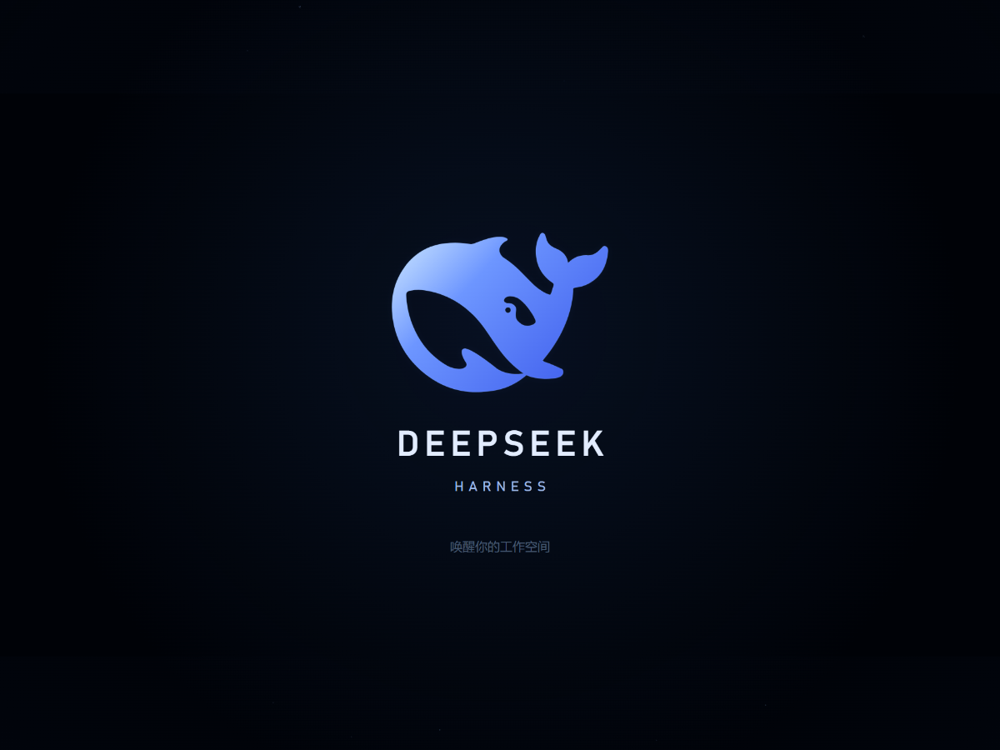

# 鲸启 · DSH Awakening

以 DSH 鲸鱼标志展开的 22 秒启动动画，包含文字组装、鲸鱼与星点流转、光带衔接和带原声欢迎语的角色片段。提供独立设置、完整预览和窗口比例适配。

基础验证环境：Windows DSH NEXT 2.0.19-next / DSH 内核 0.2.1-rc.2。这是社区兼容插件，不表示官方发布或背书。

项目地址：<https://github.com/MingoYung/dsh-awakening>。



上图为隔离播放器的比例适配预览；它不代表最早的 NEXT 桌面加载页已被替换。

## 设置入口

DSH 设置 → 鲸启启动动画。

| 设置 | 默认值 | 用途 |
| --- | --- | --- |
| 开启启动动画 | 开 | 控制自动播放；关闭后仍可手动预览 |
| 播放频率 | 每次启动 | 也可选择每日首次；同一窗口刷新不会反复播放 |
| 声音 | 开 | 控制成片全部声音，包含角色欢迎语 |
| 音量 | 85% | 0–100%，宿主确认写入后保存 |
| 超时退出 | 45 秒 | 高级项，范围 25–60 秒，避免启动等待长期遮挡界面 |

面板另有完整预览和恢复默认。时长保持 22 秒，配色保持原版，避免任意变速或改色破坏原声口型及角色段衔接。

## 播放与退出

- 同步注册 index-inject，在当前宿主允许的注入时机接管客户端加载画面；NEXT 的最早默认加载页仍会先出现，详见下文。
- 使用单个原生 video，降低启动绘制开销，保持成片音画同步。
- 完整动画结束且工作界面已挂载时退出；界面较慢时短暂等待。
- 始终可按 Esc 或点“跳过”。媒体加载失败、原生加载卡片失败或超时会让出界面。
- 浏览器禁止有声自动播放时，停在起点显示“点击启用声音并播放”，不会擅自静音播放角色口型。
- 主设置由 DSH configForms 持久化；localStorage/sessionStorage 只记录播放频率。

## 安装及维护

使用 DSH 原生插件管理器的“添加插件”，输入已解压插件目录的绝对路径。也可在 DSH 终端运行 `dsh plugin add /absolute/path/to/dsh-awakening`。首次安装后重启 DSH。

若以 link 形式安装，保留这个目录；卸载时先在 DSH 插件管理器移除插件，再删除本体。仓库已包含预构建的客户端与媒体，安装时不需要执行构建脚本。未发布到 npm，请勿从同名 npm 包推断其来源。

不需要修改 DSH 安装包、全局自动播放策略或浏览器访问权限。视频使用插件自有同源资源路由，支持 GET、HEAD 与 Range。

## 画面适配

0.3.0 使用 **2560×2560 方形母版**，中央1920×1080为安全构图区。四周是从源动画新绘制的气氛背景与稀疏星光，不是对视频边缘做模糊、镜像或拉伸。运行时以安全区计算缩放，按窗口比例只截取外围多余背景。

16:9、16:10、4:3、21:9和3:4由方形母版直接铺满，仍只播放一个视频。9:16和32:9等超出母版范围的比例使用原生绘制星光兜底，不采样、糊化原视频。

尾段原素材的画外人体并不存在，因此仅对最外周边缘做透明度融合，让原片接入新背景；脸、口型和中央构图保留，欢迎语AAC音轨直接复制。扩展背景没有被模糊，也没有生成额外的人物身体。

## NEXT 首屏兼容边界

**DSH NEXT 2.0.19-next 先显示内置加载页，等待 Host 启动后才执行插件注入。插件不能覆盖最早的桌面首帧。** 本版同步订阅事件，覆盖接口允许的后续加载阶段。普通 Web 客户端或其他桌面版本的时序可能不同，不能据此保证零默认加载画面。

要让动画与 Host 同时启动，需要 NEXT 提供初始文档及静态媒体入口。本插件不修改安装包。核对过程和适配建议见 [COMPATIBILITY.md](COMPATIBILITY.md)。

公开Stable桌面实现先启动内核再创建主窗口，NEXT则并行；这能解释不同录屏的首个可见画面不同。用户参考录屏确实包含点击图标启动，但无法仅凭图像确定其桌面版本。

## 源码

- `lib/index.js`：Host 配置、设置持久化注册、首帧注入与媒体路由。
- `lib/media.js`：受限的单文件 Range 读取。
- `runtime/bootstrap.js`：早期播放与清理控制器。
- `runtime/stage.js`：同帧背景延展与窗口适配。
- `media/boot-layout.json`：方形母版和中央安全区规格。
- `src/client.jsx`：设置页面。
- `src/entry.jsx`：设置与运行时桥接。
- `lib/client.js`：预构建的客户端模块。
- `media/boot.mp4`：第三版定稿成片。
- `animation-source/`：原始动效、几何、音轨与预览文件。

客户端重建与打包：

```sh
npm install
npm run build
npm pack --ignore-scripts
```

请使用 `scripts/build.mjs`：它在 esbuild 输出外包装 DSH `window.__ModuleLoader__.load` 注册工厂。裸 CommonJS 不能作为 DSH 客户端脚本直接执行。

打开 `preview.html` 可查看方形母版在不同比例中的实际取景。源码仓库还包含 `animation-source/native-square.html` 和离线导出器 `animation-source/tools/render_square.mjs`；重建视频需额外安装 Playwright 及 FFmpeg，运行 `node animation-source/tools/render_square.mjs`。可用 `BROWSER_EXECUTABLE` 指定已有浏览器、`FFMPEG` 指定可执行文件路径。安装插件无需这些开发工具。

代码采用 MIT；DSH 鲸鱼几何与角色片段分别保留原作者及 MIT 许可，见 [CREDITS.md](CREDITS.md) 和 `licenses/`。
